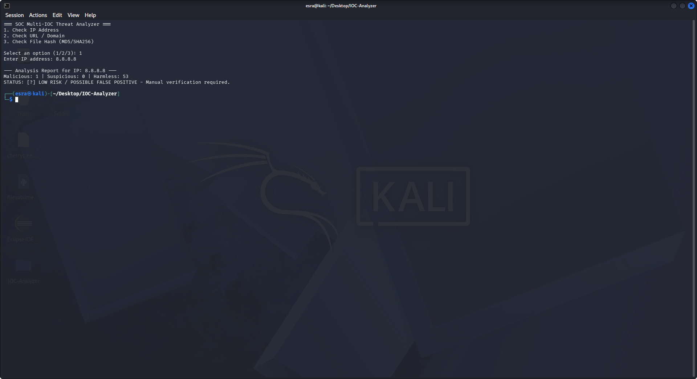

# SOC Multi-IOC Threat Analyzer

A lightweight Python CLI tool built for Security Operations Center (SOC) Tier-1 analysts to automate the enrichment and triage of Indicators of Compromise (IOCs) using the VirusTotal v3 API.

## Demo


## Features
- **IP Reputation Check:** Evaluates suspicious IPv4 addresses against 90+ security vendors.
- **URL / Domain Analysis:** Encodes URLs in Base64 format to query threat intelligence databases.
- **File Hash Lookup:** Checks MD5/SHA256 hashes for known malware signatures.
- **False Positive Filtering:** Distinguishes between single-vendor false positives and confirmed high-risk threats.
- **Secure Credential Handling:** Uses environment variables (`VT_API_KEY`) instead of hardcoded secrets.

## Setup & Usage
1. Install dependencies:
   ```bash
   pip install requests
